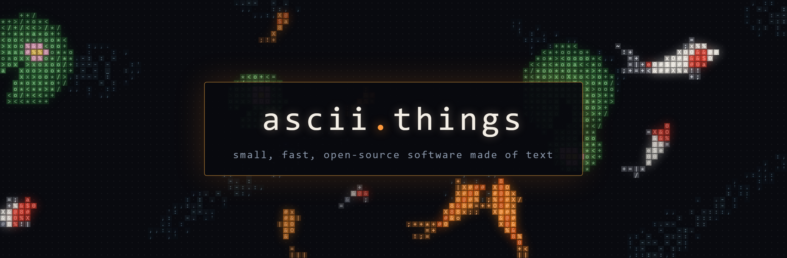

  

  <b>Small, fast, open-source software made entirely of text characters.</b> 
  Light enough to run all day, pretty enough to leave on.

---

### Projects

| | |
|---|---|
| 🐟 **[ASCII Zoo](https://github.com/ascii-things/ascii-zoo)** | A live ASCII wallpaper: koi, jellyfish, frogs and crabs swimming behind your desktop icons. Click and they rush to you. It's also a screensaver on Windows: starry skies, rain, a campfire, the aurora. Rust · about 2 MB · Windows, macOS, Linux.  **[Download](https://github.com/ascii-things/ascii-zoo/releases/latest)** · [Try it in your browser](https://github.com/ascii-things/ascii-zoo#try-it-in-your-browser) |
| ✨ *More coming soon* | |

### How we build

- **Tiny and fast.** Native Rust, no Electron, a few MB of RAM, pauses itself on battery or when you can't see it.
- **Private.** No accounts, no telemetry, nothing phones home.
- **Open source.** MIT licensed. Every release is built by GitHub Actions from the public source, with a SHA256 and a provenance attestation.
- **Built with AI.** We design and write these with [Claude Code](https://claude.com/claude-code): it lets two people ship in days what used to take months.

<code>><((('></code>&nbsp;&nbsp;made by <a href="https://github.com/dani3lfrenc">@dani3lfrenc</a> and <a href="https://github.com/Tressilloide">@Tressilloide</a>

